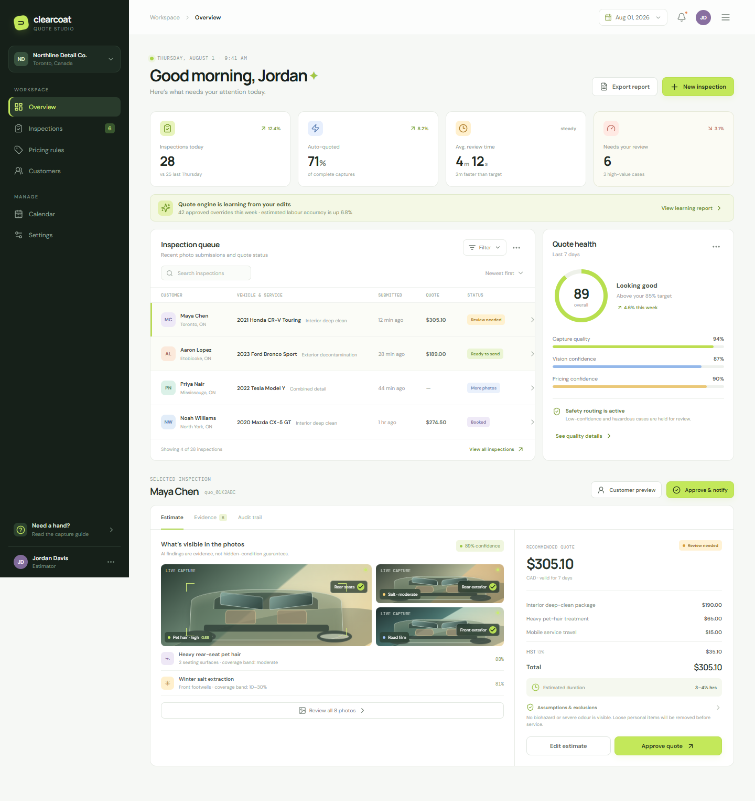

# Clearcoat Quote Studio

A vehicle-photo quoting MVP for auto-detailing teams. Photos are checked for quality; selected conditions become transparent CAD line items with review actions.



## Workflow

1. Upload vehicle photos and select the vehicle, service, and conditions.
2. Check image resolution, exposure, sharpness, and usable-photo coverage.
3. Calculate base pricing, condition add-ons, mobile travel, tax, and labour.
4. Review assumptions and evidence before approving a quote.

Low-evidence inspections request more photos or human review. The image checks assess quality; they are not a trained damage-detection model.

## Run locally

Requires Node.js 20+ and npm 10+.

```sh
npm install
npm run dev
```

Open [localhost:3000](http://localhost:3000). No environment variables are needed for the local quote workflow.

## Architecture

| Path | Purpose |
| --- | --- |
| `app/page.tsx` | Estimator and quote interface |
| `app/api/quotes/` | Quote-generation and lifecycle routes |
| `lib/quote-engine.ts` | Shared deterministic pricing and confidence routing |
| `docs/clearcoat/` | Implementation and project records |
| `screenshots/` | Sample product screens |

The UI and API use the same [quote engine](lib/quote-engine.ts). Conditions are selected or confirmed by the user; hidden damage and materially different on-site conditions require human review.

## API

- `GET /api/quotes`: seeded sample inspection
- `POST /api/quotes`: calculate a quote from service, vehicle, photo-quality, and condition inputs
- `GET/PATCH /api/quotes/:quoteId`: prototype quote-lifecycle interface

## Verify

```sh
npx tsc --noEmit
npm run build
```

## Status

Working quote-only MVP. Sample inspections illustrate the workflow. Production persistence, authentication, notifications, and server-side visual inference remain integration work. There is no payment-processing integration.

[Implementation](docs/clearcoat/IMPLEMENTATION.md) · [Progress](docs/clearcoat/PROGRESS.md) · [Research notes](docs/clearcoat/RESEARCH.md)

Contact the owner before commercial reuse of the product, branding, or screenshots; public source visibility alone does not grant a license.
